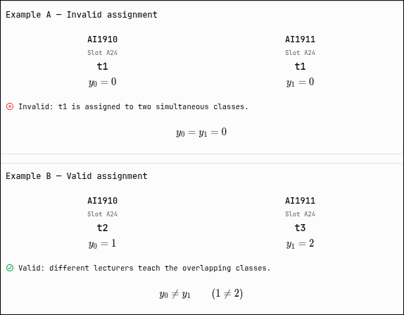

# DQI for Timetabling Problem via Max-LINSAT

Priority: Medium
Status: In progress
Type: QMOS Lab

# Tiny Dataset

InstructorSkill.csv

| **Lecturers** | **CSD201** | **DBI201** |
| --- | --- | --- |
| t1 | 5 | 5 |
| t2 | 5 | 0 |
| t3 | 0 | 5 |

A lecturer qualifies for a subject if their skill score larger than 5

$$
\text{Skill}(t_i, \text{subject}_i)\geq5
$$

- $t_1$: can teach both subject CSD201 and DBI201
- $t_2$: can teach CSD201
- $t_3$: can teach DBI201

InstructorSlot.csv

| **Lecturers** | **A24** | **A42** | **A25** | **A52** |
| --- | --- | --- | --- | --- |
| t1 | 5 | 5 | 5 | 5 |
| t2 | 5 | 5 | 5 | 5 |
| t3 | 5 | 5 | 5 | 5 |

All lecturers are available in the time slots used by this classes

$$
\text{Avail}(t_i, \text{timeslotID}_i)\geq5
$$

SlotConflict.csv

|  | **A24** | **A42** | **A25** | **A52** |
| --- | --- | --- | --- | --- |
| **A24** | 1 | 0 | 1 | 0 |
| **A42** | 0 | 1 | 0 | 1 |
| **A25** | 1 | 0 | 1 | 0 |
| **A52** | 0 | 1 | 0 | 1 |

$$
\text{SlotConflict} =
\begin{cases}
1 \quad \text{if the slot conflict (overlap)} \\
0 \quad \text{otherwise }
\end{cases}
$$

InstructorQuota.csv (Optional?)

| Lecturers | MinQuota | MaxQuota |
| --- | --- | --- |
| t1 | 1 | 3 |
| t2 | 1 | 4 |
| t3 | 1 | 2 |

Task.csv

| **Class** | **Subject** | **Slot** | **Room** | **Assigned Lecturer** |
| --- | --- | --- | --- | --- |
| AI1910 | CSD201 | A24 | DE-436 |  |
| AI1911 | DBI201 | A24 | DE-430 |  |
| AI1912 | CSD201 | A25 | DE-424 |  |

There’re 3 classes that need lecturers

In this task, AI1910 and AI1911 both at slot A24, and AI1912 at slot A25. Based on the SlotConflict.csv table, we can see that $\text{SlotConflict}(\text{A}24, \text{A25})=1$. Therefore, all three sections conflict with each other.

# Max-LINSAT Formulation

Defines $y_s \in \mathbb{F}_q$, where $y_s$ represents the lecturer assigned to section $s$. It then uses two kinds of Max-LINSAT constraints: 

$$
\underbrace{y_s \in E_s}_{\text{Lecturer eligibility}}
$$

$$
\underbrace{y_i - y_j \in \mathbb{F}_p \setminus \{0\}}_{\text{Conflicting sections}}
$$

We have 3 lecturers, so we choose the finite field $\mathbb{F}_3 = \{0, 1, 2\}$

All arithmetic is performed modulo 3. 

We define: 

$$
\mathbf{y}=(y_0, y_1, y_2)\in \mathbb{F}_3^3
$$

where: 

- $y_0$: is the lecturer assigned to AI1910
- $y_1$: is the lecturer assigned to AI1911
- $y_2$ : is the lecturer assigned to AI1912

For example, $\mathbf{y} = (1, 2, 0)$ means

| **Section** | **Field value** | **Lecturer** |
| --- | --- | --- |
| AI1910 | 1 | t2 |
| AI1911 | 2 | t3 |
| AI1912 | 0 | t1 |

## Lecturer conflict constraint

For two overlapping sections, we need $y_i \neq y_j$. Means that one lecturer cannot teach 2 classes simultaneously

This can be expressed as

$$
y_i - y_j \in \{1, 2\} \quad\text{mod}\space3
$$

or we can write it as 

$$
\underbrace{
\begin{bmatrix}
1 & -1 & 0
\end{bmatrix}
}_{b_0}
\begin{bmatrix}
y_0\\
y_1\\
y_2
\end{bmatrix}
\in \{1, 2\}\quad\text{mod}\space3
$$

since $-1 \equiv 2\space\text{mod}\space3$. Therefore,  $b_0=\begin{bmatrix}1&2&0\end{bmatrix}$.

Repeat this for 3 conflict pairs

| **Constraint** | **Expression** | **Coefficient row** |
| --- | --- | --- |
| $C_1$ | $y_0-y_1$ | $\begin{bmatrix}1&2&0\end{bmatrix}$ |
| $C_2$ | $y_0-y_1$ | $\begin{bmatrix}1&0&2\end{bmatrix}$ |
| $C_3$ | $y_1-y_2$ | $\begin{bmatrix}0&1&2\end{bmatrix}$ |

## Lecturer Eligibility Constraints

| **Section**  | **Variable** | **Eligible Lecturer** |
| --- | --- | --- |
| AI1910 | $y_0$ | $t_1, t_2$ |
| AI1911 | $y_1$ | $t_1, t_3$ |
| AI1912 | $y_2$ | $t_1, t_2$ |

For class AI1910, $y_0=0$ or $y_0=1$, therefore, $y_0 \in\{0, 1\}$. Or it can be expressed as

$$

\begin{bmatrix}
1 & 0 & 0
\end{bmatrix}
\begin{bmatrix}
y_0\\
y_1\\
y_2
\end{bmatrix}
\in \{0, 1\}
$$

Apply the same for 3 classes we obtain 

| **Constraint** | **Expression** | **Coefficient row** |
| --- | --- | --- |
| $C_4$ | $y_0$ | $\begin{bmatrix}1&0&0\end{bmatrix}$ |
| $C_5$ | $y_1$ | $\begin{bmatrix}0&1&0\end{bmatrix}$ |
| $C_6$ | $y_2$ | $\begin{bmatrix}0&0&1\end{bmatrix}$ |

## The complete Max-LINSAT system

Combine all six rows 

With acceptance sets 

$$
B=\begin{bmatrix}
1&2&0\\
1&0&2\\
0&1&2\\
1&0&0\\
0&1&0\\
0&0&1
\end{bmatrix}
$$

$$
F_0=\{1, 2\}\\
F_1=\{1, 2\}\\
F_2=\{1, 2\}\\
F_3=\{0, 1\}\\
F_4=\{0, 2\}\\
F_5=\{0, 1\}\\
$$

Thus, the optimization problem becomes

$$
\max_{y\in\mathbb{F}_3^3}S(\mathbf{y})=\sum_{i=0}^5\mathbf{1}[(B_i\mathbf{y})\space\text{mod}\space3\in F_i]
$$

Each satisfied constraint contributes one point. The maximum possible score is 6.

# Construct the ideal DQI sampling distribution

### Construct the constraint functions

We have 27 possible assignments since $\mathbf{y}\in\mathbb{F}_3^3$. 

Transform each constraint into a function. For each row $i$ of our matrix, define: 

$$
h_i(\mathbf{y})=\begin{cases}1\quad\text{if constraint}\space i\space\text{is satisfied}\\
0\quad\text{otherwise}\end{cases}
$$

Therefore, satisfaction score is

$$
S(\mathbf{y})=\sum_{i=0}^5h_i(\mathbf{y})
$$

Construct a normalization function

$$
g_i(\mathbf{y})=\frac{h_i(\mathbf{y})-a_i}{\sqrt{a_i(1-a_i)}}
$$

where $a_i=\frac{|F_i|}{q}=\frac{2}{3}\forall i$ in this tiny example. Therefore, 

$$
g_i(\mathbf{y})=\begin{cases}\frac{1}{\sqrt{2}}\quad \text{if satisfied}\\-\sqrt{2}\quad\text{otherwise}\end{cases}
$$

We can represent all 27 lecturer assignment into a superposition

$$
\lvert\psi\rangle=\sum_{\mathbf{y}\in\mathbb{F}_3^3}A(\mathbf{y})\lvert\mathbf{y}\rangle
$$

under uniform sampling, $A(\mathbf{y})=\frac{1}{\sqrt{27}}$. Therefore, $P(\mathbf{y})=(\frac{1}{\sqrt{27}})^2=\frac{1}{27}\approx3.70\%$

<aside>
💡

DQI’s idea is to replace these equal amplitudes with amplitudes determined by a polynomial of our optimization score.

</aside>

### Construct polynomial basis functions

For degree $\ell=0$: 

For degree $\ell = 1$: 

$$
\phi_0(\mathbf{y})=\frac{1}{\sqrt{27}}
$$

$$
\phi_1(\mathbf{y})=\frac{\sum_{i=0}^6g_i(\mathbf{y})}{\sqrt{6\cdot27}}
$$

This produces a uniform state

Degree-1 basis depends on the number of satisfied constraints

For degree $\ell$: 

$$
\phi_\ell(\mathbf{y})\propto\sum_{i<j<k<\dots}g_i(\mathbf{y})g_j(\mathbf{y})g_k(\mathbf{y})\dots
$$

Higher degrees include higher-order combinations of constraint functions

### Find the best coefficients

After constructing the basis, Ideal DQI considers states of the form

$$
\lvert\psi_\ell\rangle=\sum_{k=0}^{\ell}w_k\lvert\phi_k\rangle=w_0\lvert\phi_0\rangle+w_1\lvert\phi_1\rangle+\dots+w_k\lvert\phi_k\rangle
$$

Then these coefficients are solved as an eigenvalue optimization problem

$$
\max_{\lvert\psi\rangle\in\mathcal{V}_\ell, \|\psi\|=1}\langle\psi\lvert\hat{S}\lvert\psi\rangle
$$

where 

- $\mathcal{V}_\ell$ is the polynomial subspace
- $\hat{S}$ is the diagonal operator containing every assignment’s score
- $\lvert\psi\rangle$ is the state being optimized

### Convert amplitudes into probabilities

Once the coefficients are chosen: 

$$
\psi_\ell(\mathbf{y})=\sum_{k=0}^\ell w_k\phi_k(\mathbf{y})
$$

The probability of sampling assignment $\mathbf{y}$ is $P_\ell(\mathbf{y})=|\psi_\ell(\mathbf{y})|^2$

<aside>
⛔

Ideal DQI implementation is **not a scalable solver**.

</aside>

If we had 100 sections and 3 lecturers: $p^n=3^{100}\approx5.15\times10^{47}$, Enumerating these states become impractical

## General Fourier expansion over $\mathbb{F_q}$

Any function

$$
f:\mathbb{F}_q\rightarrow\mathbb{C}
$$

can be expressed as a linear combination of the Fourier basis functions

$$
f(z)=\sum_{a\in\mathbb{F}_q}\hat{f}(a)\mathcal{X}_a(z)
$$

where: 

- $\mathcal{X}_a(z)$ is a Fourier basis function
- $\hat{f}(a)$  is its Fourier coefficient
- $\hat{f}(a)\mathcal{X}_a(z)$ is a **Fourier term**

### Expand the polynomial into Fourier terms

Each polynomial basis function can be expressed using Fourier characters

$$
\psi_\ell(\mathbf{y})=\sum_{\substack{
\mathbf{e} \in \mathbb{F}_p^m \\
\mathrm{wt}(\mathbf{e}) \leq \ell
}}a_{\mathbf{e}}\mathcal{X}_1((B^T\mathbf{e})^T\mathbf{y})
$$

## Prepare the error register

We have six constraints $C_0, C_1, C_2, C_3, C_4, C_5$, DQI introduces another vector $\mathbf{e}=(e_0, e_1, e_2, e_3, e_4, e_5)$ with $e_i\in\mathbb{F}_3=\{0, 1, 2\}$

The error vector is **not** our lecturer assignment.

- $\mathbf{y}$ has three elements and describes lecturers
- $\mathbf{e}$ has six elements and indexes Fourier components associated with constraints

A nonzero $e_i$ does not mean constraint $i$ has been violated. The term *error* comes from the decoding interpretation used by DQI

For degree $\ell=1$, we consider the error vectors whose Hamming weight is at most one

$$
\text{wt}(\mathbf{e})\leq\ell\Leftrightarrow\text{wt}(\mathbf{e})\leq1
$$

Hamming weight simply means the number of nonzero entries

| **Error vector** | **Hamming Weight** | **Included?** |
| --- | --- | --- |
| (0, 0, 0, 0, 0, 0) | 0 | Yes |
| (1, 0, 0, 0, 0, 0) | 1 | Yes |
| (0, 2, 0, 0, 0, 0) | 1 | Yes |
| (1, 0, 2, 0, 0, 0) | 2 | No |

| **Error Value** | **Meaning** |
| --- | --- |
| $e_i=0$ | The constraint’s Fourier term is not selected |
| $e_i=1$ | Select its first nonzero Fourier component  |
| $e_i=2$ | Select its second nonzero Fourier component |

Since there are six positions and two possible nonzero values at each position (degree $\ell=1$)

$$
N_{\textit{error}}=\sum_{k=0}^\ell \text{C}_m^k(q-1)^k=1+6(2)=13
$$

There are the 13 Fourier error patterns supported by our degree-one construction.

The error register stores a superposition: 

$$
\lvert\psi_E\rangle = \sum_{\mathbf{e}} \alpha_{\mathbf{e}} \lvert\mathbf{e}\rangle
$$

For degree $\ell=1$: 

$$
\lvert\psi_E\rangle = \alpha_0 |0\rangle
+ \sum_{i=1}^{6} \sum_{a=1}^{2}
\alpha_{a\mathbf{u}_i} \lvert a\mathbf{u}_i\rangle
$$

where $\mathbf{u}_i$ is a vector with 1 at position $i$ and 0 otherwise. Therefore, the error register represent a superposition over 13 error pattern.

## Compute the syndrome

We have: 

$$
B=\begin{bmatrix}
1&2&0\\
1&0&2\\
0&1&2\\
1&0&0\\
0&1&0\\
0&0&1
\end{bmatrix} \in\mathbb{F}^{6\times3}_3
$$

The syndrome is 

$$
\mathbf{z}=B^T\mathbf{e}\quad\text{mod}\space3\in\mathbb{F}_3^3
$$

The syndrome is three elements long, compared with six for the error vector

| **Error vector $\mathbf{e}$** | **Syndrome $\mathbf{z}$** |
| --- | --- |
| (0, 0, 0, 0, 0, 0) | (0, 0, 0) |
| (1, 0, 0, 0, 0, 0) | (1, 2, 0) |
| (2, 0, 0, 0, 0, 0) | (2, 1, 0) |
| (0, 0, 0, 1, 0, 0) | (1, 0, 0) |

Its role is to contain enough information for the decoder to identify which error pattern produced it.

The quantum operation produces:

$$
\lvert\mathbf{e}\rangle\lvert\mathbf{z}\rangle=\sum_{\mathbf{e}}a_{\mathbf{e}}\lvert\mathbf{e}\rangle\lvert B^T\mathbf{e}\rangle
$$

## Decoder

After syndrome computation, our quantum state contains: 

$$
\lvert\Psi\rangle=\sum_{\mathbf{e}}a_{\mathbf{e}}\lvert\mathbf{e}\rangle\lvert B^T\mathbf{e}\rangle
$$

The decoder receives the syndrome and choose one representative error:

$$
D(\mathbf{z})=\hat{\mathbf{e}}
$$

It the subtracts that error from the error register: 

$$
\lvert\mathbf{e}\rangle\lvert\mathbf{z}\rangle\rightarrow\lvert\mathbf{e}-D(\mathbf{z})\rangle\lvert\mathbf{z}\rangle\rightarrow\lvert0\rangle\lvert\mathbf{z}\rangle
$$

### What if two errors have the same syndrome?

Let’s focus only on two error patterns that share syndrome $\mathbf{z}$

$$
\lvert\Psi\rangle=a_1\lvert\mathbf{e}_1\rangle\lvert\mathbf{z}\rangle+a_2\lvert\mathbf{e}_2\rangle\lvert\mathbf{z}\rangle
$$

$$
D(\mathbf{z})=\mathbf{e}_1
$$

Apply to both terms

$$
\begin{aligned}
&\lvert\mathbf{e}\rangle\lvert\mathbf{z}\rangle\rightarrow\lvert\mathbf{e_1}-D(\mathbf{z})\rangle\lvert\mathbf{z}\rangle\rightarrow\lvert0\rangle\lvert\mathbf{z}\rangle\\
&\lvert\mathbf{e}\rangle\lvert\mathbf{z}\rangle\rightarrow\lvert\mathbf{e_2}-D(\mathbf{z})\rangle\lvert\mathbf{z}\rangle\rightarrow\lvert\mathbf{e_2}-\mathbf{e}_1\rangle\lvert\mathbf{z}\rangle
\end{aligned}
$$

The resulting state becomes

$$
\lvert\Psi\rangle=a_1\lvert0\rangle\lvert\mathbf{z}\rangle+a_2\lvert\mathbf{r}\rangle\lvert\mathbf{z}\rangle
$$

where $\lvert\mathbf{r}\rangle=\lvert\mathbf{e_2}-\mathbf{e}_1\rangle\neq\lvert0\rangle$.

Therefore, after decoding, the resulting state are 

$$
\lvert\Psi_{\text{decoded}}\rangle=\sum_{\mathbf{e}}\alpha_\mathbf{e}\lvert\mathbf{e}-D(B^T\mathbf{e})\rangle\lvert B^T\mathbf{e}\rangle
$$

or (perfect decoding)

$$
\lvert\Psi_{\text{decoded}}\rangle=\lvert0\rangle\otimes\sum_{\mathbf{e}}\alpha_{\mathbf{e}}\lvert B^T\mathbf{e}\rangle
$$

## Apply the Quantum Fourier Transform

After decoding

$$
|\Psi_{\mathrm{decoded}}\rangle
=
\sum_{\mathbf{e}} \alpha_{\mathbf{e}}
\underbrace{|\mathbf{r}_{\mathbf{e}}\rangle}_{\text{Residual-error register}}
\underbrace{|\mathbf{s}_{\mathbf{e}}\rangle}_{\text{Syndrome register}}
$$

We apply: 

$$
\lvert\Psi_{\text{final}}\rangle=(I\otimes\text{QFT}^{-1})\lvert\Psi_{\text{decoded}}\rangle
$$

The transformation is : 

$$
\underbrace{|\mathbf{r}\rangle}_{\text{Unchanged}}
\otimes
\underbrace{|\mathbf{s}\rangle}_{\text{Apply QFT}^{-1}}
\quad \longrightarrow \quad
|\mathbf{r}\rangle \otimes
\underbrace{
\left(
\frac{1}{\sqrt{q^n}}
\sum_{\mathbf{y}\in\mathbb{F}_q^n}
\omega^{-\mathbf{s}^T\mathbf{y}}
|\mathbf{y}\rangle
\right)
}_{\text{Assignment superposition}}
$$

Finally, we measure the assignment register, obtaining a candidate lecturer assignment $\mathbf{y}$.
