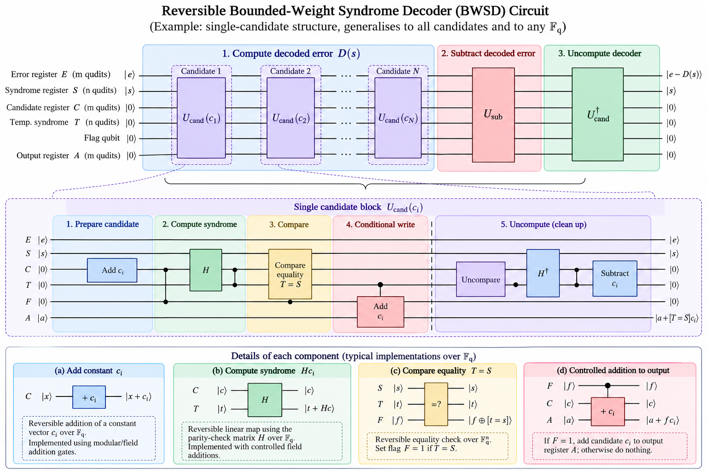

# DQI’s Decoder

# Recall

Consider a general finite field $\mathbb{F}_q$, where $q$ is a prime number. 

The Max-LINSAT problem has the form

$$
\max_{\mathbf{x}\in\mathbb{F}_q^n}f(\mathbf{x})=\sum_{i=1}^{m}w_i\mathbf{1}[\mathbf{b}_i^T\mathbf{x}\in F_i]
$$

where:

- $q$  : number of field elements
- $n$ : number of decision variables
- $m$ : number of linear constraints
- $B\in\mathbb{F}_q^{m\times n}$ : constraint matrix
- $\ell$ : DQI polynomial degree, controlling the maximum error weight

Define the syndrome matrix

$$
H=B^{T}\in\mathbb{F}_q^{n\times m}
$$

During DQI, the error vector $\mathbf{e}\in\mathbb{F}_q^m$ is associated with a syndrome:

$$
\mathbf{s}=H\mathbf{e}
$$

The decoder receives $\mathbf{s}$ and produces an estimated error vector: 

$$
D(\mathbf{s})=\hat{\mathbf{e}}
$$

Ideally, $\hat{\mathbf{e}}=\mathbf{e}$. The decoding operation is embedded in the quantum circuit as 

$$
\lvert\mathbf{e}\rangle\lvert\mathbf{s}\rangle\longrightarrow\lvert\mathbf{e}-D(\mathbf{s})\rangle\lvert\mathbf{s}\rangle
$$

If decoding is successful, $\lvert\mathbf{0}\rangle\lvert\mathbf{s}\rangle$.

All the decoders aim to solve the same mathematical problem. They differ in how they find $\hat{\mathbf{e}}$, how many computational resources they require, and how easily they can be implemented as reversible quantum operations. 

In short, 

$$
\boxed{\text{Syndrome }\mathbf{s}}\longrightarrow\boxed{\text{Decoder }D}\longrightarrow \boxed{\text{Error Estimate }\hat{\mathbf{e}}}
$$

# Lookup Table (LUT)

A LUT decoder solves the decoding problem in advance and stores the result. For each syndrome $\mathbf{s}$, the table contains an error estimate: 

$$
D_{\text{LUT}}(\mathbf{s})=\hat{\mathbf{e}}
$$

For example, imagine a code with the following syndrome table: 

| **Syndrone** | **Stored error estimate** |
| --- | --- |
| $\mathbf{s}_0$ | (0, 0, 0, 0) |
| $\mathbf{s}_1$ | (1, 0, 0, 0) |
| $\mathbf{s}_2$ | (0, 2, 0, 0) |
| $\mathbf{s}_3$ | (0, 0, 1, 0) |

When decoder receives $\mathbf{s}_2$, it simply looks up the corresponding error vector

$$
\text{Syndrome}\space\space\mathbf{s}\rightarrow\text{LUT }\text{(stored mapping)}\rightarrow\text{Error estimate}\space\space\hat{\mathbf{e}}
$$

# Bounded-Weight Syndrome Decoder (BWSD)

Instead of storing the mapping between all syndromes and error vectors, we search directly for an error vector with limited Hamming weight.

Since DQI uses error vectors with $\text{wt}(\mathbf{e})\leq\ell$, we search for candidates $\mathbf{e}'$ satisfying:

$$
H\mathbf{e}'=\mathbf{s}, \quad \text{wt}(\mathbf{e}')\leq\ell
$$

Therefore, 

- If $\ell=1$, we search errors with at most one nonzero element.
- If $\ell=2$, we search errors with at most two nonzero elements.
- If $\ell=3$, we search errors with at most three nonzero elements.

Suppose the syndrome matrix is $H\in\mathbb{F}_q^{n\times m}$. For a bounded weight $\ell$, we construct the candidate set

$$
\mathcal{E}_\ell=\{\mathbf{e}\in\mathbb{F}_q^m:\text{wt}(\mathbf{e})\leq\ell\}
$$

For each candidate $\mathbf{e}'\in\mathcal{E}_\ell$, we test $H\mathbf{e}'=\mathbf{s}$. 

The decoder returns a matching candidate, typically using minimum Hamming weight and a fixed tie-breaking rule.

For any field $\mathbb{F}_q$, the number of candidate errors of weight at most $\ell$ is

$$
N_\text{error}(\ell)=\sum_{k=0}^\ell \text{C}_m^k(q-1)^k
$$

### Example

Suppose $q=3, m=6, \ell=1$, with the constraint matrix and syndrome matrix are 

$$
B=\begin{bmatrix}
1&2&0\\
1&0&2\\
0&1&2\\
1&0&0\\
0&1&0\\
0&0&1
\end{bmatrix}_{6\times3}
\quad\text{and}\quad
H=B^T=\begin{bmatrix}
1&1&0&1&0&0\\
2&0&1&0&1&0\\
0&2&2&0&0&1
\end{bmatrix}_{3\times 6}

$$

Suppose the original error vector is 

$$
\mathbf{e}=\begin{bmatrix}
0\\0\\2\\0\\0\\0
\end{bmatrix}
$$

Calculate its syndrome

$$
\mathbf{s}=H\mathbf{e}\space(\text{mod }3)=\begin{bmatrix}0\\2\\4\end{bmatrix}\space\text{mod }3=\begin{bmatrix}0\\2\\1\end{bmatrix}
$$

The decoder receives only $\mathbf{s}$ and its job is to determine which error vector produced this syndrome

$$
\boxed{\text{Syndrome }\mathbf{s}}\longrightarrow\boxed{\text{Decoder }D}\longrightarrow \boxed{\text{Error Estimate }\mathbf{e}'}
$$

**Generate candidate errors**

Because $\ell=1$, only errors of weight 0 or 1 are considered

There’re $N_{\text{error}}=\text{C}_6^0+\text{C}_6^1(3-1)=1+12=13$ candidates

**Calculate candidate syndromes**

| **Candidate error $\mathbf{e}'$** | **Calculated $H\mathbf{e}'$** | **Match?** |
| --- | --- | --- |
| (0, 0, 0, 0, 0, 0) | (0, 0, 0) | No |
| (1, 0, 0, 0, 0, 0) | (1, 2, 0) | No |
| (2, 0, 0, 0, 0, 0) | (2, 1, 0) | No |
| (0, 1, 0, 0, 0, 0) | (1, 0, 2) | No |
| (0, 2, 0, 0, 0, 0) | (2, 0, 1) | No |
| (0, 0, 1, 0, 0, 0) | (0, 1, 2) | No |
| (0, 0, 2, 0, 0, 0) | (0, 2, 1) | Yes |

Therefore, $\hat{\mathbf{e}}=(0, 0, 2, 0, 0, 0)^T$.

**Remove the error information**

Quantum state before decoding: $\lvert\mathbf{e}\rangle\lvert\mathbf{s}\rangle$. The reversible decoder computes $\hat{\mathbf{e}}=D(\mathbf{s})$ and subtracts it from the error register

$$
\lvert\mathbf{e}\rangle\lvert\mathbf{s}\rangle\longrightarrow\lvert\mathbf{e}-\hat{\mathbf{e}}\rangle\lvert\mathbf{s}\rangle
$$

Since the decoding succeeded, $\mathbf{e}-\hat{\mathbf{e}}=\mathbf{0}$. The resulting state is $\lvert0\rangle\lvert\mathbf{s}\rangle$

### BWSD work inside a quantum circuit

Before decoding, the relevant DQI state is

$$
\lvert\Psi\rangle=\sum_{\mathbf{e}}a_{\mathbf{e}}\underbrace{\lvert\mathbf{e}\rangle}_{\text{Error}}\space
\underbrace{\lvert H\mathbf{e}\rangle}_{\text{Syndrome}}
$$

where $H=B^T$

We need additional quantum registers. A reversible BWSD circuit can use the following registers: 

| **Register** | **Purpose** | **Initial value** |
| --- | --- | --- |
| $E$ | Original error vector  | $\mathbf{e}$ |
| $S$ | Syndrome | $\mathbf{s}$ |
| $C$ | Current candidate error | $\mathbf{0}$ |
| $T$ | Candidate’s calculated syndrome | $\mathbf{0}$ |
| $F$ | Flag indicating a match | $0$ |
| $A$ | Decoded error estimate | $\mathbf{0}$ |

**Generate a candidate error reversibly**

Assume our degree is $\ell=1$, the decoder considers vectors with at most 1 nonzero element. 

For example, 

$$
\mathbf{c}_0=(0, 0, 0, 0, 0, 0)\\
\mathbf{c}_1=(1, 0, 0, 0, 0, 0)\\
\mathbf{c}_2=(2, 0, 0, 0, 0, 0)\\
\vdots\\
\mathbf{c}_6=(0, 0, 2, 0, 0, 0)\\
\vdots
$$

Suppose a candidate register begins at zeros

$$
\lvert C\rangle=\lvert000000\rangle
$$

We want to prepare: 

$$
\lvert000000\rangle\longrightarrow\lvert002000\rangle
$$

We can apply a finite-field addition gate that adds the constant candidate vector.

For general $\mathbb{F}_q$, define

$$
U_{\text{add}}(\mathbf{c})=\lvert\mathbf{z}\rangle\rightarrow\lvert\mathbf{z}+\mathbf{c}\rangle
$$

This operation is reversible because we can apply its inverse

$$
U_{\text{add}}^{-1}(\mathbf{c})=\lvert\mathbf{z}\rangle\rightarrow\lvert\mathbf{z}-\mathbf{c}\rangle
$$

**Compute the candidate syndrome** 

After preparing a candidate $\mathbf{c}$, we need to calculate 

$$
\mathbf{t}=H\mathbf{e}
$$

This is performed reversibly. The operation is 

$$
U_H=\lvert\mathbf{c}\rangle\lvert\mathbf{t}\rangle\rightarrow\lvert\mathbf{c}\rangle\lvert\mathbf{t}+H\mathbf{c}\rangle
$$

Initially, $\lvert\mathbf{t}\rangle=\lvert\mathbf{0}\rangle$. Therefore, 

$$
\lvert\mathbf{e}\rangle\lvert\mathbf{0}\rangle\xrightarrow{U_H}\lvert\mathbf{c}\rangle\lvert H\mathbf{e}\rangle
$$

**Compare the candidate syndrome with the input syndrome** 

Introduce a flag qubit $\lvert F\rangle=\lvert0\rangle$. The comparison is implemented as 

$$
\lvert s\rangle\lvert t\rangle\lvert f\rangle \rightarrow \lvert s\rangle\lvert t\rangle\lvert f \oplus [s=t]\rangle
$$

Here, $[s=t]$ is 1 if the syndromes match and 0 otherwise. For example

$$
\lvert021\rangle_{S}\lvert021\rangle_{T}\lvert0\rangle_F\rightarrow\lvert021\rangle_{S}\lvert021\rangle_{T}\lvert1\rangle_F
$$

**Write the matching candidate into the output register**

We perform a controlled finite-field addition

$$
\lvert f\rangle\lvert\mathbf{c}\rangle\lvert\mathbf{a}\rangle\rightarrow\lvert f\rangle\lvert\mathbf{c}\rangle\lvert\mathbf{a}+f\mathbf{c}\rangle
$$

If $F=0$, the output register remains unchanged.

**Uncompute temporary registers**

We want to retain the decoded estimate in $A$, but reset the temporary register $C=0,\space T=0,\space F=0$. 

Because temporary registers containing candidate or comparison information may remain entangled with the syndrome superposition. We need to clean them before continuing the DQI algorithm.

**Subtract the estimated error from the original error**

The decoder performs:

$$
\lvert\mathbf{e}\rangle\lvert\hat{\mathbf{e}}\rangle\rightarrow\lvert\mathbf{e}-\hat{\mathbf{e}}\rangle\lvert\hat{\mathbf{e}}\rangle
$$

The output register $A$ still contains the decoded error, we want to clear it as well. Because $A$ was computed from the unchanged syndrome register $S$, we can run the entire decoder-computation circuit in reverse to erase $A$. The complete operation: 

$$
|e\rangle |s\rangle |0\rangle_A
\longrightarrow
|e\rangle |s\rangle |D(s)\rangle_A
\longrightarrow
|e-D(s)\rangle |s\rangle |D(s)\rangle_A
\longrightarrow
|e-D(s)\rangle |s\rangle |0\rangle_A
$$

**How does this work for a superposition?**

The actual DQI state is: 

$$
\lvert\Psi\rangle=\sum_\mathbf{e}a_{\mathbf{e}}\lvert\mathbf{e}\rangle\lvert H\mathbf{e}\rangle
$$

The same circuit acts on all components of the superposition simultaneously, due to linearity. The result is 

$$
\lvert\Psi_{\text{after}}\rangle=\sum_\mathbf{e}a_{\mathbf{e}}\lvert\mathbf{e}-D(H\mathbf{e})\rangle\lvert H\mathbf{e}\rangle
$$

If every erro in the support of the state is decoded correctly, $D(H\mathbf{e})=\mathbf{e}$, then: 

$$
\lvert\Psi_{\text{after}}\rangle=\lvert\mathbf{0}\rangle_E\otimes\sum_\mathbf{e}a_{\mathbf{e}}\lvert H\mathbf{e}\rangle_S
$$

Now the error register is disentangled and can be ignored safely

**Circuit**

# Errors share the same syndrome

### The problem

Suppose the dataset produces $B \in \mathbb{F}_q^{m\times n}$, where 

- $m$: is the number of constraints
- $n$ : is the number of assignment variables (the number of classes that need to assign lecturers)
- $q$ : is the finite-field

**Number of candidate errors** 

For maximum Hamming weight $\ell$

$$
N_\text{error}(\ell)=\sum_{k=0}^\ell\text{C}_m^k(q-1)^k
$$

This degree depends only on $m, q, \ell$, not the actual entries of $B$

**Number of possible syndromes**

Since 

$$
\mathbf{s}=B^T\mathbf{e}\quad(\text{mod }q)
$$

The syndrome contains $n$ elements of $\mathbb{F}_q$. 

**Number of distinct syndromes at degree $\ell$**

Define 

$$
E_\ell=\{\mathbf{e}\in\mathbb{F}_q^m: \text{wt}(\mathbf{e})\leq\ell\}
$$

Then 

$$
N_\text{unique}(\ell)=|\{B^T\mathbf{e}:\mathbf{e}\in E_\ell\}|
$$

**Example**

Suppose we have three error patterns

$$
\mathbf{e}_1=(1, 0, 0, 0, 0, 0)\\
\mathbf{e}_2=(0, 0, 0, 1, 2, 0)\\
\mathbf{e}_3=(0, 1, 0, 0, 0, 0)
$$

| **Error** | **Syndrome** | **Amplitude** |
| --- | --- | --- |
| $\mathbf{e}_1$ | $\mathbf{s}_A=(1, 2, 0)$ | 1 |
| $\mathbf{e}_2$ | $\mathbf{s}_A=(1, 2, 0)$ | 2 |
| $\mathbf{e}_3$ | $\mathbf{s}_B=(1, 0, 2)$ | 1 |

The initial error-syndrome state, after syndrome computation is

$$
\lvert\Psi\rangle=\frac{1}{\sqrt{6}}(\lvert\mathbf{e}_1\rangle\lvert\mathbf{s}_A\rangle+2\lvert\mathbf{e}_2\rangle\lvert\mathbf{s}_A\rangle+\lvert\mathbf{e}_3\rangle\lvert\mathbf{s}_B\rangle)
$$

$\mathbf{e}_1$ and $\mathbf{e}_2$ have the same syndrome. A decoder using only $\mathbf{s}_A$ cannot identify which one was present.

### Collision-aware amplitude aggregation

Instead of asking: *“Which error produced this syndrome?”*. We ask: *“What is the total amplitude contributed by all errors producing this syndrome?”*

For any syndrome $\mathbf{s}$, define: 

$$
A(\mathbf{s})=\sum_{\mathbf{e}:B^T\mathbf{e}=\mathbf{s}}a_{\mathbf{e}}
$$

And then we group errors by syndrome. For example

|  | **Syndrome A $\mathbf{s}_A=(1, 2, 0)$** | **Syndrome B** |
| --- | --- | --- |
|  | Error 1 : +1 | Error 3 : +1 |
|  | Error 2 : +2 | Other errors : +0 |
| **Combined amplitude** | +3 | +1 |

Therefore, $A(\mathbf{s}_A)=3$ and $A(\mathbf{s}_B)=1$. The resulting desired syndrome state is 

$$
\lvert\Psi_\text{syn}\rangle=\frac{3\lvert\mathbf{s}_A\rangle+\lvert\mathbf{s}_B\rangle}{\sqrt{10}}
$$

The original error register is no longer necessary, we’re constructing a state containing only the syndrome information, but with the correct *coherently summed amplitudes.*

**Prepare the syndrome state directly**

For the tiny dataset, there’re $3^3=27$ possible syndromes. 

We can build an amplitude vector containing 27 entries, with each entry corresponding to a syndrome in $\mathbb{F}_3^3$. 

$$
\mathbf{A}=\begin{bmatrix}
A(0, 0, 0)\\
A(0, 0, 1)\\
\vdots\\
A(2, 2, 2)
\end{bmatrix}
$$

And then normalize it 

$$
\hat{\mathbf{A}}=\frac{\mathbf{A}}{\|\mathbf{A}\|}
$$

We **no** longer need an LUT or BWSD decoder in this direct-state-preparation workflow

We calculate the desired amplitudes classically and prepare the final syndrome state directly

**Apply inverse QFT**

Once we have, 

$$
\lvert\Psi_\text{syn}\rangle=\frac{1}{\mathcal{N}}\sum_\mathbf{s}A(\mathbf{s})\lvert\mathbf{s}\rangle
$$

We apply

$$
\lvert\Psi_\text{output}\rangle=\text{QFT}^-1\lvert\Psi_\text{syn}\rangle
$$

# Quantum Eraser + Post selection 

Assume the Max-XORSAT experiment has: 
$$
m=5, \quad n=4, \quad \ell=4
$$
The problem occurs when two different errors generate the same syndrome. For example, suppose: 
$$
e_1 \neq e_2, \quad B^T e_1 = B^T e_2 = s 
$$
A deterministic decoder receives $s$ and must choose a **single** estimate $\hat{e}$. It cannot output both $e_1$ and $e_2$ for the same input. 
Therefore, at least one branch cannot be reset correctly by that decoder. 
Quantum eraser & Post Selection is an alternative method to avoid guessing which original error occured. 
### Step 1: Apply Hadamard gates to the error register 
Instead of decoding the syndrome into a particular error, we apply $H^{\otimes m}$ to the error register. 
For one qubit: 
$$
H\lvert 0\rangle = \frac{\lvert 0\rangle + \lvert 1 \rangle}{\sqrt{2}}=\lvert + \rangle\\
H\lvert 1\rangle = \frac{\lvert 0\rangle - \lvert 1 \rangle}{\sqrt{2}}=\lvert - \rangle
$$
For $n$ qubits: 
$$
H^{\otimes n}\lvert e\rangle = \frac{1}{\sqrt{2^n}}\sum_{z\in\{0, 1\}^n}(-1)^{e\cdot z}\lvert z\rangle
$$

### Step 2: Postselect a successful outcome
Keep only the error-register outcome $z=00000$, and discard the others. If we measure `00000`, we retain that run and read the resulting problem-variable distribution. Otherwise, we discard the run.

- **Why this work?**
Because the amplitude of `00000` contains contributions from every prepared error, including errors that sharing the same syndrome. We combine those contributions through interference rather than selecting one representative error. 
- **Limiations**: The desired outcome may occur with very low probability. 

### Step 3: Improve postselection using feedforward 
Feedforward correction is the step that allows your Quantum Eraser to accept error-register outcomes other than $\lvert 00000\rangle$
Quantum Eraser applies Hadamard gates to the error register: $H^{\otimes 5}\lvert e\rangle$. Afterward, we measure the error register and obtain some five-bit result $z$. 

**How feedforward calculates the correction?** 
The Max-XORSAT problem uses: 
$$
B = \begin{bmatrix}
1 & 0 & 0 & 0 \\ 
1 & 1 & 0 & 0 \\ 
0 & 0 & 1 & 1 \\ 
0 & 0 & 0 & 1
\end{bmatrix}
$$
We want to find a four-bit vector $t$ satisfying 
$$
Bt=z \quad(\text{mod } 2)
$$
Here: 
- $z$: is the measured five-bit error-register outcome. 
- $t$: is the four-bit feedforward correction. 
- $B$: is the matrix defining the Max-XORSAT problem
For example, let's say we measure $z=00011$, solving the equation gives $t=0001$.
We can verify: 
$$
B
\begin{bmatrix}
0\\0\\0\\1
\end{bmatrix} =
\begin{bmatrix}
0\\0\\0\\1\\1
\end{bmatrix}
=z
$$
Therefore, the result `00011` can be corrected with $t=0001$

**Why can some outcomes not be corrected?** 
For this particular matrix $B$, the equation $Bt=z$ has a solution precisely when z has *even parity*. 
For example, 

| **Measure** $z$ | **Correction** $t$ | **Action**               | 
| ----------- | -------------- | ----------------------- | 
| `00000`     | `0000`         | Accept, no change       |
| `00011`     | `0001`         | Accept, XOR with `0001` |
| `00110`     | `0010`         | Accept, XOR with `0010` |
| `01100`     | `0100`         | Accept, XOR with `0100` |
| `11000`     | `1000`         | Accept, XOR with `1000` |
| `00001`     | `None`         | Rejected                |
| `11111`     | `None`         | Rejected                |

`00001` rejected because no four-bit $t$ satisfies $Bt=00001$. 
Therefore, the measured outcome cannot be corrected using this syndrome-side feedforward rule. 

### Grover Amplitude Amplification 
Grover is operated before measurement to **increase the probability** that the error register produces an accepted outcome. 

### Final Distinction 
| **Technique** | **Purpose** | 
| ----------- | -------------- | 
| Quantum Eraser | Interfere contributions from different errors without choosing a unique decoded error | 
| PostSelection | Retain only outcomes for which a valid correction exists | 
| FeedForward | Use measured $z$ to calculate $t$, then correct the output via $x\oplus t$ | 
| Grover | Increase the probability that the measurement produces an accepted $z$ | 

